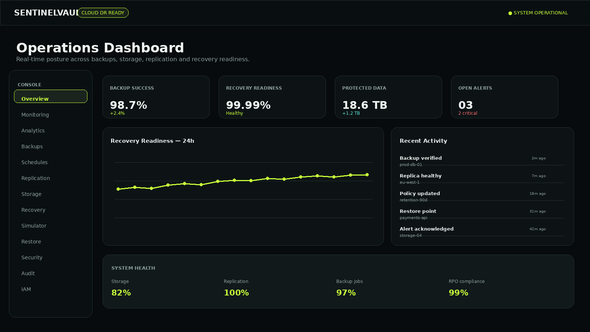
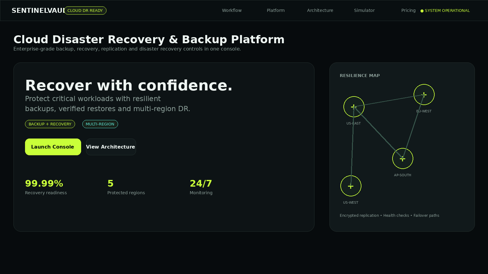
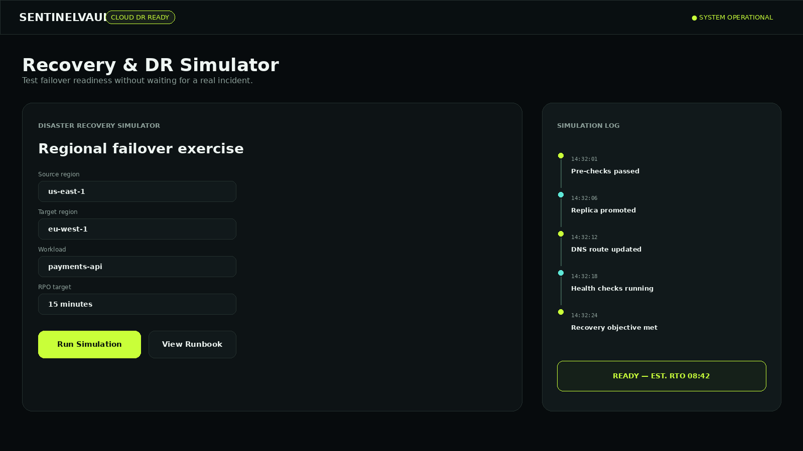
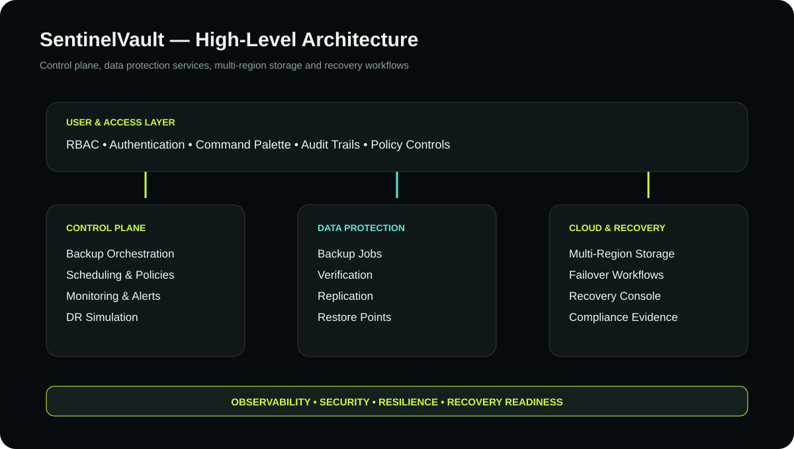

# SentinelVault

> **Cloud Disaster Recovery & Backup Platform**

SentinelVault is a premium cloud disaster-recovery and backup operations console for monitoring protected workloads, backup health, replication, recovery workflows and disaster simulations.



## ✨ Features

- Executive operations dashboard with RPO/RTO and storage KPIs
- Backup orchestration and backup history
- Cross-region replication monitoring
- Recovery center and restore workflows
- Disaster Recovery Simulator
- Restore Center
- Monitoring, analytics and operational charts
- Backup scheduling
- Security and IAM
- Role-based access controls
- Audit and compliance logs
- Notifications and command palette
- Responsive premium interface with interactive cards, charts and modals

## 🖥️ Website Preview

### Landing Page


### Operations Dashboard


### Recovery Center


### Architecture


## 📁 Project Structure

```text
SentinelVault/
│
├── README.md
├── package.json
├── package-lock.json
├── .env.example
├── .gitignore
├── eslint.config.js
├── vite.config.js
├── index.html
│
├── public/
│   ├── favicon.svg
│   └── assets/
│       ├── landing-preview.png
│       ├── dashboard-preview.png
│       ├── recovery-preview.png
│       └── architecture.svg
│
├── src/
│   ├── main.js
│   └── styles.css
│
├── server/
│   └── server.js
│
└── dist/
    └── .gitkeep
```

`node_modules/` is intentionally excluded and is generated by `npm install`.

## 🛠️ Technology Stack

| Layer | Technology |
|---|---|
| Frontend | HTML5, JavaScript ES6 |
| UI | Tailwind CSS CDN + Custom CSS |
| Charts | Chart.js |
| Animation | GSAP |
| Build | Vite |
| Server | Express.js |
| Fonts | Inter, Space Grotesk, JetBrains Mono |

## 🚀 Run Locally

```bash
npm install
npm run dev
```

Open `http://localhost:5173`.

### Production build

```bash
npm run build
```

### Preview production build

```bash
npm run preview
```

### Optional Express server

```bash
npm start
```

Health endpoint: `/api/health`

## 🧭 Application Modules

```text
Landing
 ├── Workflow
 ├── Platform
 ├── Architecture
 ├── Simulator
 └── Pricing

Operations Console
 ├── Overview
 ├── Monitoring
 ├── Analytics
 ├── Backups
 ├── Schedules
 ├── Replication
 ├── Storage
 ├── Recovery
 ├── DR Simulator
 ├── Restore Center
 ├── Security
 ├── Audit & Compliance
 ├── IAM
 └── Architecture
```

## 🔐 Roles

| Role | Purpose |
|---|---|
| Admin | Full platform administration |
| Operator | Backup, restore, scheduling and DR operations |
| Auditor | Audit and report access |
| Viewer | Read-only visibility |

## ☁️ Architecture

```text
                    ┌─────────────────────────┐
                    │      SentinelVault      │
                    │    Web Operations UI    │
                    └────────────┬────────────┘
                                 │
                    ┌────────────▼────────────┐
                    │     API / RBAC Layer    │
                    └────────────┬────────────┘
                                 │
              ┌──────────────────┼──────────────────┐
              │                  │                  │
       ┌──────▼──────┐    ┌──────▼──────┐    ┌──────▼──────┐
       │ Backup Jobs │    │ Replication │    │ Recovery    │
       │ & Policies  │    │ & Regions   │    │ & Failover  │
       └──────┬──────┘    └──────┬──────┘    └──────┬──────┘
              │                  │                  │
              └──────────────────┼──────────────────┘
                                 │
                    ┌────────────▼────────────┐
                    │ Storage / Audit / Logs  │
                    └─────────────────────────┘
```

## 📊 Demo Scope

The supplied build is a fully interactive browser-based demonstration. Navigation, dashboard modules, filters, simulations, charts, modals, notifications, role controls and UI workflows operate locally.

For production use, the frontend can be connected to real authentication, cloud storage, databases, backup APIs, monitoring services and job queues.

## 📤 GitHub Upload

```bash
git init
git add .
git commit -m "Initial SentinelVault platform"
git branch -M main
git remote add origin YOUR_GITHUB_REPOSITORY_URL
git push -u origin main
```

## 🎓 Academic Project

**Project:** SentinelVault — Cloud-Based Disaster Recovery & Backup Platform  
**Domain:** Cloud Computing / Distributed Systems / Disaster Recovery

## 📄 License

Educational, demonstration and portfolio use.
